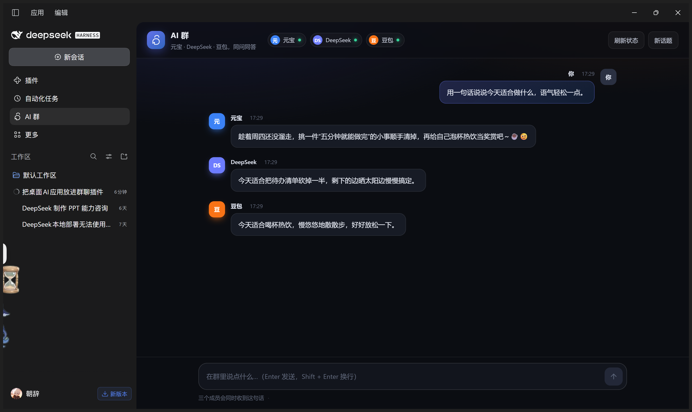

# dsh-ai-group · AI Group

[](https://github.com/lt309629-pixel/dsh-ai-group/stargazers)
[](LICENSE)
[](https://github.com/lt309629-pixel/dsh-ai-group)

Put **Yuanbao (元宝)**, **DeepSeek**, and **Doubao (豆包)** in one group chat. Ask once, get three answers in a single timeline.

[中文 README](README.md) · [Architecture](docs/architecture.svg) · [GitHub](https://github.com/lt309629-pixel/dsh-ai-group)



A [DeepSeek Harness](https://deepseek.com) (DSH) plugin: it adds an **AI Group** entry to the sidebar and renders the group chat in the main panel. No API keys, no window juggling.

## Features

- **One prompt, three answers.** A single composer broadcasts to all three members; replies are shown per member.
- **Per-member context.** Yuanbao and Doubao keep their own web conversations; "New topic" starts a fresh chat on both.
- **Member status.** Dots show connected / login required / not started, with a "Log in" button when needed.
- **No API keys.** Yuanbao and Doubao use your logged-in web sessions; DeepSeek uses the model of the current DSH session.
- **Non-intrusive.** Messages are injected into the page, so sending never steals focus from DSH.

## Requirements

| Item | Requirement |
|---|---|
| DSH | `>= 0.2.1-rc.5` (`engines.dsh`) |
| Node | bundled with DSH, `>= 22.12` |
| OS | Windows / macOS (Edge first, then Chrome) |
| Accounts | Yuanbao and Doubao, logged in once each |

## Install

**From the DSH plugin page (recommended)**

Sidebar → Plugins → Add plugin → search `dsh-ai-group` → install / enable. The **AI Group** entry appears without restarting DSH.

**From a local folder (development)**

Plugins page → "Install third-party plugin" → enter:

```
link:C:\path\to\dsh-ai-group
```

## First run

1. Click **AI Group** in the sidebar.
2. Send a message. The plugin launches a **dedicated browser window** (Edge or Chrome, isolated profile) and pre-loads both web apps.
3. If Yuanbao / Doubao shows "login required", click **Log in** and scan the QR code in the browser window. The session is kept for next time.
4. Keep chatting in the group.

## How it works


- The DSH Host plugin serves `/ai-group` (page + JSON API) in-process.
- Yuanbao and Doubao are driven through the browser's DevTools Protocol: navigate, inject text, click send, read the newly appeared reply.
- DeepSeek is called through DSH's `ctx.llm` with the model of the current session.
- Login state, browser profile, and the chosen debug port live in `%USERPROFILE%\.dsh\ai-group\` (`~/.dsh/ai-group/` on macOS/Linux).
- The debug port is picked from `9225–9234` and remembered, so conflicts with other tools are handled automatically.

**Privacy:** there is no relay server. Your prompts go from the local browser to the vendor web apps you are already signed into; DeepSeek requests use your existing DSH configuration.

## Limitations

- Web UIs change; selectors may break. Open an issue with a screenshot — the fix is usually in `lib/adapters.js`.
- One chat turn is bounded at 75 seconds per member. A stuck member is marked red while the others still answer.
- Chromium-based browsers only (Edge or Chrome must be installed).
- Only one group turn runs at a time.

## Development

```
lib/index.js      host routes
lib/chat.js       turn orchestration + DeepSeek adapter
lib/adapters.js   Yuanbao / Doubao DOM adapters
lib/browser.js    browser discovery, port selection, CDP client
lib/client.js     sidebar entry + main slot (classic script, no build)
assets/           the group chat page (vanilla HTML/CSS/JS)
docs/             architecture diagram
```

There is no build step. Edit files and restart/reload the plugin.

## License

MIT
