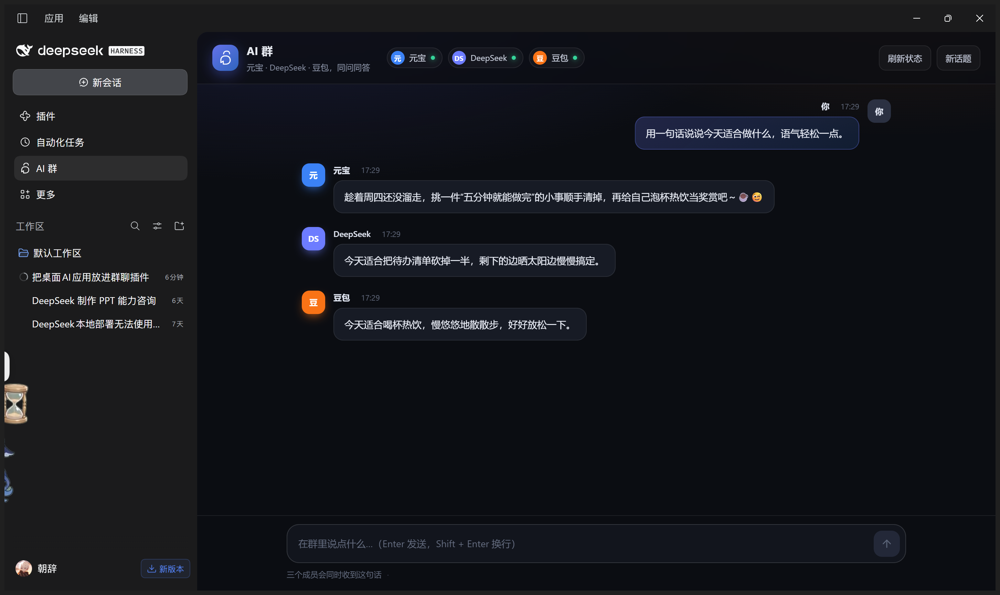

# dsh-ai-group · AI 群

[](https://github.com/lt309629-pixel/dsh-ai-group/stargazers)
[](LICENSE)
[](https://github.com/lt309629-pixel/dsh-ai-group)

[English](README.en.md) · [架构图](docs/architecture.svg) · [GitHub 仓库](https://github.com/lt309629-pixel/dsh-ai-group)

把 **元宝、DeepSeek、豆包** 拉进同一个群聊。你问一句，三家同时回答，答案都落在同一个时间线里。



这是一个 [DeepSeek Harness](https://deepseek.com)（DSH）插件：侧边栏会多一个「AI 群」入口，主区域就是群聊页面。不用 API Key，也不用切窗口。

## 功能

- **同问同答**：一个输入框，消息同时发给三家，回复按成员分别展示。
- **各自记上下文**：元宝、豆包各用自己的网页会话，可以连续追问；「新话题」会让三家都开新对话。
- **成员状态**：顶部状态灯显示已连接 / 需登录 / 未启动；需要登录时给出「去登录」按钮。
- **不用 API Key**：元宝、豆包走你已经登录的网页版；DeepSeek 走 DSH 当前会话的模型。
- **不抢焦点**：发送靠页面内注入，不会把 DSH 窗口切走。

## 环境要求

| 项目 | 要求 |
|---|---|
| DSH | `>= 0.2.1-rc.5`（`engines.dsh`） |
| Node | 由 DSH 自带，`>= 22.12` |
| 系统 | Windows / macOS（自动查找 Edge，其次 Chrome） |
| 账号 | 元宝、豆包各登录一次（扫码即可） |

## 安装

**方式一：DSH 插件页（推荐）**

侧边栏「插件」→ 添加插件 → 搜索 `dsh-ai-group` 安装 / 启用。装好后侧栏出现「AI 群」，不用重启。

**方式二：本地目录（开发用）**

插件页选择「安装第三方插件」，输入：

```
link:C:\你的路径\dsh-ai-group
```

## 第一次使用

1. 点侧栏 **AI 群**。
2. 发一句话。插件会自动拉起一个**专用浏览器窗口**（Edge 或 Chrome，独立配置目录，不影响你日常浏览器的登录）。
3. 如果元宝/豆包显示未登录，点群页面顶部的「去登录」，在弹出的窗口里扫码。**登录一次，之后长期有效。**
4. 回到群里继续提问即可。

## 它是怎么工作的


- 插件 Host 在 DSH 的本地进程里注册 `/ai-group` 路由，提供页面和 API。
- 元宝、豆包通过浏览器远程调试协议（CDP）驱动：打开网页、写入输入框、点发送、读取新出现的回复。
- DeepSeek 通过 DSH 的 `ctx.llm` 调用当前会话使用的模型。
- 登录态、端口和浏览器配置都存放在 `%USERPROFILE%\.dsh\ai-group\`（macOS/Linux 为 `~/.dsh/ai-group/`）。
- 调试端口从 `9225` 起自动挑选并记住，避免端口冲突。

**隐私**：插件不经过任何自建服务器。你的问题由本地浏览器直接发给你已登录的元宝/豆包网页，DeepSeek 的请求由 DSH 按你现有配置发出。

## 几个设计取舍

- **不用 API Key**：接三家官方 API 要三套账号、三份密钥和计费，门槛太高；用已登录的网页版，用户只需扫码一次。
- **不自己开 Electron 窗口**：DSH 的 Host 是 Node 模式子进程，拿不到 `BrowserWindow`；直接驱动系统浏览器反而更稳，也复用了用户熟悉的登录流程。
- **回复判定用「文本变化 + 节点标记」而不是消息条数**：豆包的消息列表会虚拟化，条数经常不变；给旧消息打标记、只认新节点，重复问同一个问题也能区分。
- **端口不写死**：从 `9225` 起自动探测并记住，端口被占用时自动换下一个，避免装完就用不了。

## 项目结构

```
lib/index.js      Host 路由（页面 + JSON API）
lib/chat.js       一轮群聊的编排 + DeepSeek 适配器
lib/adapters.js   元宝 / 豆包的 DOM 适配
lib/browser.js    浏览器发现、端口选择、CDP 客户端
lib/client.js     侧栏入口 + 整页插槽（经典脚本，无需构建）
assets/           群聊页面（原生 HTML/CSS/JS）
docs/             架构图
```

## 已知限制

- 网页版是第三方产品，改版可能让选择器失效；出问题时把页面截图发到 issue，通常改 `lib/adapters.js` 里的选择器即可。
- 单轮最多等 75 秒；某一家卡住时另外两家照常显示，卡住的那家会标红。
- 需要本机安装 Edge 或 Chrome；只支持 Chromium 系浏览器。
- 同一时间只跑一轮群聊（回答中不能再次发送）。

## 卸载

DSH 插件页停用 / 删除即可。若要清掉浏览器登录态，删除 `~/.dsh/ai-group/`。

## License

MIT
